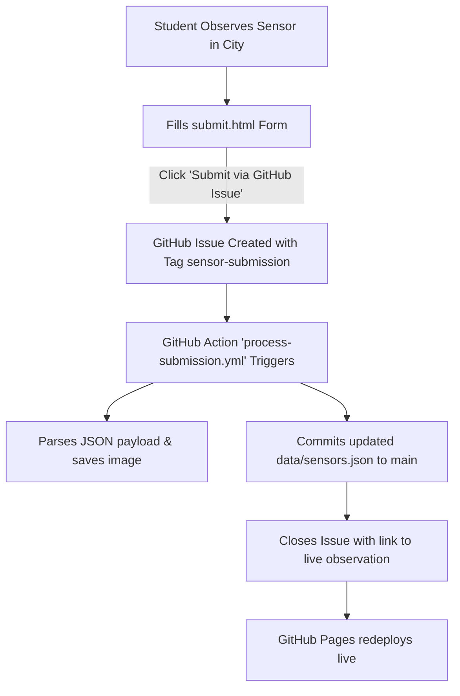

# CASA0014 Urban Tech & Connected Environments Observatory

[](https://ucl-casa-ce.github.io/casa0014-urbantech/)
[](https://www.ucl.ac.uk/bartlett/casa/)

An interactive web platform and living spatial archive for [UCL CASA0014](https://github.com/ucl-casa-ce/casa0014) (*Connected Environments*) students to observe, document, analyse, and map physical urban sensors and IoT infrastructure across London.

This platform provides a searchable observatory featuring interactive maps, detail pages, and automated GitHub-driven submission workflows.

---

## 🌟 Key Features

1. **Interactive London Sensor Map (`index.html`)**:
   - Built with [Leaflet.js](https://leafletjs.com/) and CartoDB Voyager tiles.
   - Categorized custom SVG markers (Air Quality, Mobility, Weather, Energy, Infrastructure).
   - Filter by domain, live keyword search across parameters and locations.
   - Switch between **Split Map & Cards**, **Full Map**, and **Gallery Grid** views.
2. **Dedicated Sensor Dossier Pages (`sensor.html?id=...`)**:
   - Field photography with click-to-zoom lightbox.
   - Interactive mini-map centered on the exact installation.
   - "What is being sensed?" context and parameter badges.
   - "Questions Raised on Site" discussion prompts.
   - Location card with 1-click coordinate copying, [what3words](https://what3words.com) badge, and Google Maps navigation.
3. **Online Submission Form (`submit.html`)**:
   - Click-to-place map pin with **automatic reverse geocoding** (auto-fills latitude, longitude, and street address).
   - "Use Current Location" GPS button for mobile field submissions.
   - Drag-and-drop photo uploader with canvas optimization.
   - Dynamic question prompts builder.
   - Direct integration with GitHub Issues or JSON export.

---

## 🚀 How Student Submissions Work



1. **Intake**: A student submits via `submit.html` or directly via GitHub Issue Form (`.github/ISSUE_TEMPLATE/sensor_submission.yml`).
2. **Automation**: A GitHub Action (`.github/workflows/process-submission.yml`) parses the issue, downloads the photo, updates `data/sensors.json`, and commits back to `main`.
3. **Instant Publishing**: GitHub Pages serves the updated observation immediately at `sensor.html?id=[slug]`.

---

## 💻 Local Development & Preview

Because this is built with standard web technologies (Vanilla HTML5, CSS3, and JavaScript), no compilation, build steps, or package installations are required.

To preview locally on your computer:

```bash
# Using Python:
python3 -m http.server 8000

# OR using Node / npx:
npx serve .
```

Then open `http://localhost:8000` in your web browser.

---

## 📦 Setting Up the New Repository (`ucl-casa-ce/casa0014-urbantech`)

To publish this observatory to its dedicated GitHub repository:

1. **Create the empty repository** on GitHub under the `ucl-casa-ce` organization named `casa0014-urbantech`.
2. **Initialize git and push**:
   ```bash
   cd /path/to/casa0014-urbantech
   git init
   git branch -M main
   git add .
   git commit -m "feat: initial release of CASA0014 Urban Tech Observatory"
   git remote add origin git@github.com:ucl-casa-ce/casa0014-urbantech.git
   git push -u origin main
   ```
3. **Enable GitHub Pages**:
   - Go to **Settings** → **Pages** in the new repository.
   - Under **Build and deployment** > **Source**, select `Deploy from a branch`.
   - Choose `main` branch and `/ (root)` folder, then click **Save**.
   - Your site will be live at `https://ucl-casa-ce.github.io/casa0014-urbantech/`!
4. **Enable GitHub Actions Permissions**:
   - Go to **Settings** → **Actions** → **General**.
   - Under **Workflow permissions**, select `Read and write permissions`.
   - Check `Allow GitHub Actions to create and approve pull requests`.
   - Click **Save**.

---

## 📂 Project Structure

```text
casa0014-urbantech/
├── index.html              # Observatory landing page (Leaflet map + card stream)
├── sensor.html             # Dynamic sensor dossier template
├── submit.html             # Interactive submission form with Leaflet picker
├── README.md               # Documentation & setup guide
├── css/
│   └── style.css           # Design system, glassmorphism, responsive styles
├── js/
│   ├── app.js              # Map controls, live search, and filtering
│   ├── sensor.js           # Detail view renderer & mini-map
│   └── submit.js           # Location picker, geocoding & GitHub bridge
├── data/
│   └── sensors.json        # Master manifest of urban sensor observations
├── assets/
│   └── images/             # Field photography archive
└── .github/
    ├── workflows/
    │   └── process-submission.yml # Automated intake pipeline
    └── ISSUE_TEMPLATE/
        └── sensor_submission.yml  # Structured issue submission template
```

---

## 🏛️ UCL CASA Connected Environments
Created for the **CASA0014: Connected Environments** MSc module at the **Centre for Advanced Spatial Analysis (CASA)**, University College London.
